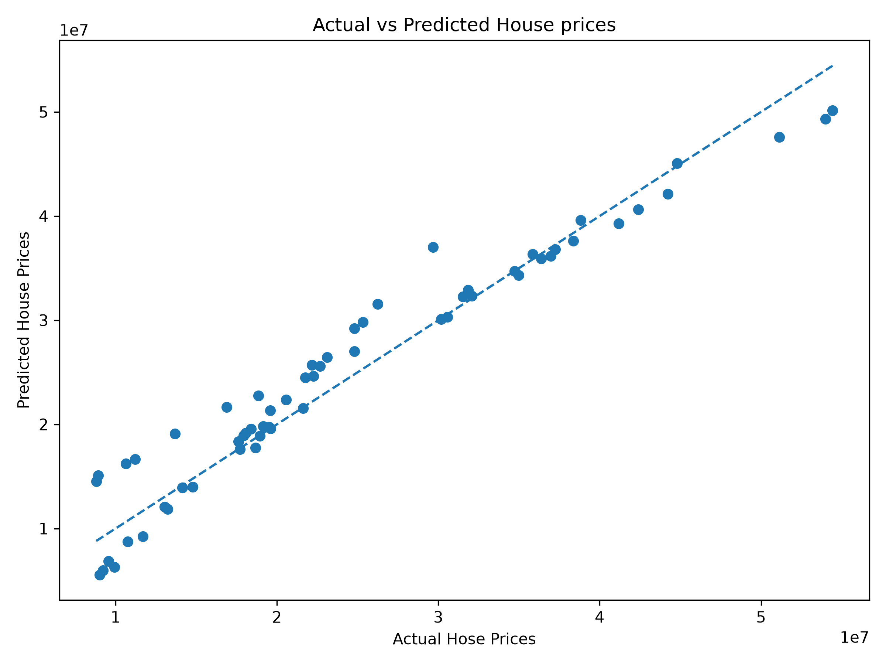
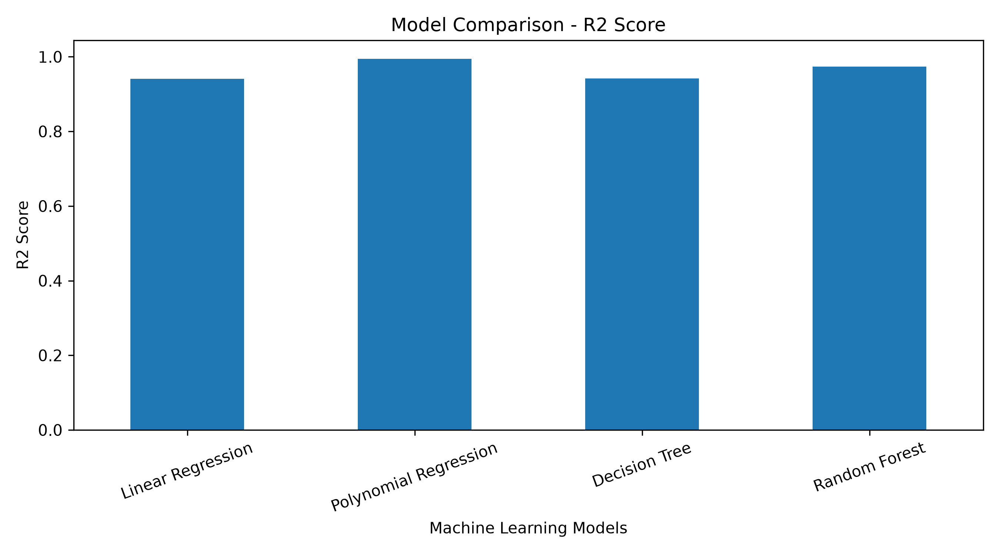
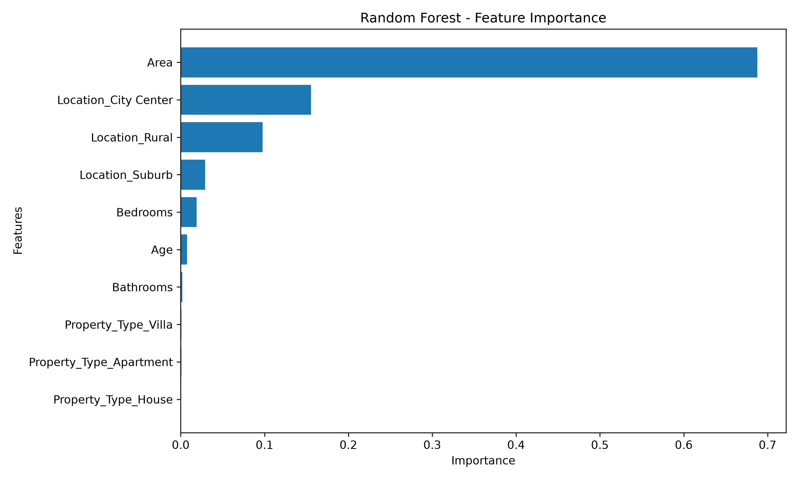
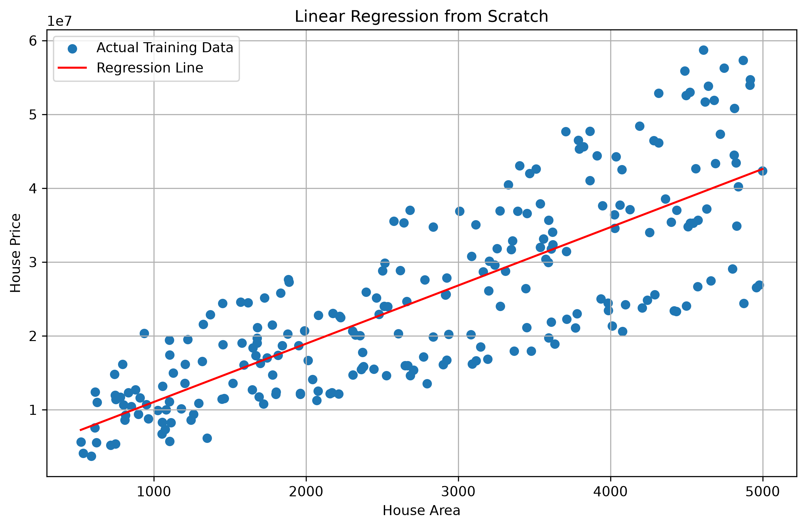

# 🏠 House Price Prediction Using Machine Learning

## 📌 Project Overview

This project focuses on predicting house prices using machine learning regression algorithms.

The objective is to estimate property prices based on important characteristics such as area, number of bedrooms, bathrooms, property age, location, and property type.

Four regression models were implemented, evaluated, and compared to identify the best-performing model.

This project was completed as part of a Python and Data Analytics internship.

## 🎯 Project Objectives

- Explore and understand housing data.
- Perform data cleaning and preprocessing.
- Apply One-Hot Encoding to categorical variables.
- Build multiple machine learning regression models.
- Evaluate models using MAE, RMSE, and R² Score.
- Perform five-fold cross-validation.
- Analyze feature importance.
- Interpret results and derive business insights.

## 📂 Project Structure

```text
House-Price-Prediction/
│
├── house_price_prediction.ipynb
├── house_prices.csv
├── model_evaluation_report.md
├── README.md
├── requirements.txt
│
├── predictions_vs_actual.png
├── model_comparison.png
├── feature_importance.png
└── regression_line.png
```

## 📊 Dataset Description

The dataset contains 300 property records and 8 columns.

| Feature | Description |
|---|---|
| Property_ID | Unique property identifier |
| Area | Property area |
| Bedrooms | Number of bedrooms |
| Bathrooms | Number of bathrooms |
| Age | Property age |
| Location | Property location |
| Property_Type | Type of property |
| Price | Target variable |

**Dataset Summary:**
- Total records: 300
- Total columns: 8
- Missing values: 0
- Duplicate records: 0
- Target variable: `Price`

## 🛠️ Technologies Used

| Technology | Purpose |
|---|---|
| Python | Programming |
| Pandas | Data analysis |
| NumPy | Numerical operations |
| Matplotlib | Visualization |
| Seaborn | Statistical visualization |
| Scikit-learn | Machine learning |
| Jupyter Notebook | Development environment |
| Git & GitHub | Version control |

## ⚙️ Project Workflow

### 1. Data Understanding and EDA
- Inspected dataset structure and data types.
- Checked missing values and duplicate records.
- Analyzed descriptive statistics.
- Examined feature correlations.
- Created exploratory visualizations.

### 2. Data Preprocessing
- Separated input features and target variable.
- Removed `Property_ID` from the predictive features.
- Applied One-Hot Encoding to categorical columns.
- Split the dataset into training and testing sets.

**Train-Test Split:**
- Training data: 80% (240 records)
- Testing data: 20% (60 records)

### 3. Model Development

Four regression algorithms were implemented:

1. Linear Regression
2. Polynomial Regression (Degree 2)
3. Decision Tree Regression
4. Random Forest Regression (100 estimators)

### 4. Model Evaluation

The following metrics were used:

- **MAE:** Mean Absolute Error
- **RMSE:** Root Mean Squared Error
- **R²:** Coefficient of Determination

## 📈 Model Performance Comparison

| Model | MAE | RMSE | R² Score |
|---|---:|---:|---:|
| Linear Regression | 2,188,736.34 | 2,907,633.21 | 0.9406 |
| Polynomial Regression | 714,540.73 | 896,287.75 | 0.9944 |
| Decision Tree | 2,194,416.67 | 2,864,232.30 | 0.9424 |
| Random Forest | 1,453,575.83 | 1,932,346.94 | 0.9738 |

### 🏆 Best-Performing Model

**Polynomial Regression**

- Test MAE: 714,540.73
- Test RMSE: 896,287.75
- Test R²: 0.9944
- Five-fold CV Average R²: 0.9909
- CV Standard Deviation: 0.00223

Polynomial Regression achieved the strongest results among the four models in this experiment.

## 🔍 Cross-Validation Results

Five-fold cross-validation was performed using the training dataset.

| Model | Average CV R² | Standard Deviation |
|---|---:|---:|
| Linear Regression | 0.9529 | 0.00768 |
| Polynomial Regression | 0.9909 | 0.00223 |
| Decision Tree | 0.9401 | 0.00586 |
| Random Forest | 0.9710 | 0.00447 |

Polynomial Regression achieved the highest average cross-validation R² and the lowest standard deviation.

## 📊 Visualizations

### 1. Actual vs Predicted House Prices



### 2. Model Comparison



### 3. Feature Importance



### 4. Linear Regression Line



## 💡 Feature Importance Insights

Random Forest feature importance identified the following influential features:

| Feature | Importance |
|---|---:|
| Area | 0.687588 |
| Location_City Center | 0.155224 |
| Location_Rural | 0.097460 |
| Location_Suburb | 0.029165 |
| Bedrooms | 0.018998 |
| Age | 0.007601 |

**Key observations:**
- Area was the most influential feature.
- Location was another important factor.
- Bedrooms had relatively low importance.
- Age and bathrooms had lower importance in this model.

Feature importance represents relative model reliance, not causal effects on house prices.

## 📌 Business Insights

The analysis suggests that area and location deserve particular attention when estimating property prices.

Potential home buyers can use these findings as an additional reference when comparing properties.

Other factors, including property condition, age, connectivity, and maintenance requirements, should also be considered before purchasing a house.

## ⚠️ Limitations

- The dataset contains only 300 records.
- The dataset may not represent all housing markets.
- The models have not been validated across different cities and market conditions.
- The test dataset was used to compare multiple models, so its performance estimate may be optimistic.
- Further validation is required before real-world deployment.

## 🚀 Future Improvements

- Use a larger and more representative dataset.
- Add more property and neighborhood features.
- Implement preprocessing pipelines.
- Perform hyperparameter tuning.
- Validate using a separate, untouched test dataset.
- Develop a web application for interactive house price prediction.

## 💻 Installation and Usage

### Step 1: Clone the repository

```bash
git clone <(https://github.com/Deeksha412-c/House_Price_Prediction)>
```

### Step 2: Navigate to the project directory

```bash
cd House-Price-Prediction
```

### Step 3: Install dependencies

```bash
pip install -r requirements.txt
```

### Step 4: Launch Jupyter Notebook

```bash
jupyter notebook
```

### Step 5: Open the notebook

Open `house_price_prediction.ipynb` and execute the cells.

## 📄 Project Documentation

For detailed methodology, model evaluation, cross-validation, feature importance, and business insights, refer to:

`model_evaluation_report.md`

## 🎓 Internship Project

**Project:** House Price Prediction Using Machine Learning

**Domain:** Python and Data Analytics / Machine Learning

**Project Type:** Regression

**Status:** Completed

---

## 👩‍💻 Author

**Deeksha**

GitHub: [(https://github.com/Deeksha412-c)](https://github.com/Deeksha412-c)

---

⭐ If you find this project useful, consider giving the repository a star.
